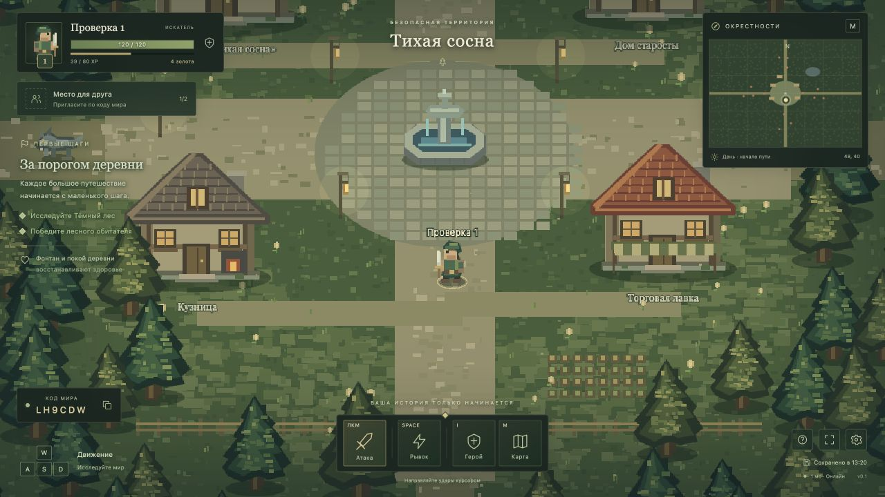

# Village Survival: The Forgotten Lands

Кооперативная браузерная Action RPG для двух игроков. Реализован **только первый этап** из `maket.txt`, включая дополнения о постоянном мире. Второй этап не начат.



## Запуск

Нужен **Node.js 22.13+** (подойдёт 24 LTS) и npm. SQLite встроен в Node.js, отдельная установка базы не нужна. Node 22 может выводить уведомление `ExperimentalWarning` для `node:sqlite`.

```sh
npm ci
npm run dev
```

Открыть **http://localhost:3000**. Клиент Vite и Socket.IO работают на одном порту. Сервер слушает `0.0.0.0`, поэтому доступен и другим компьютерам при разрешённом сетевом доступе.

Для готовой сборки:

```sh
npm run build
npm start
```

Настройки через переменные окружения: `PORT` (по умолчанию `3000`), `HOST` (`0.0.0.0`), `DB_PATH` (по умолчанию `data/village.sqlite`).

## Как играть вдвоём

1. Первый игрок вводит имя, выбирает внешний вид и нажимает **«Создать приключение»**. Это выбор облика, классы относятся ко второму этапу.
2. Код постоянного мира отображается в левом нижнем углу игры. Нажатие копирует код.
3. Друг открывает **адрес того же сервера**, выбирает **«Присоединиться»** и вводит код. У каждого своя камера; можно исследовать разные части карты.
4. В мире закрепляются два постоянных героя. Их места сохраняются и после выхода. Для другого состава создайте новый мир.
5. Чтобы продолжить, выберите мир в **«Ваши путешествия»** на главном экране. Второй игрок может вернуться по тому же коду.

Для локальной сети друг использует `http://<локальный-IP-сервера>:3000`, а не `localhost`. Для интернета разместите Node.js на доступном сервере или настройте проброс порта. Рекомендуется HTTPS с обратным прокси, поддерживающим WebSocket. **Публичный хостинг и доступ с двух физических компьютеров через интернет в этой среде не проверялись.**

Пример Nginx для Node.js, уже запущенного на `127.0.0.1:3000` (домен и TLS настраиваются отдельно):

```nginx
location / {
    proxy_pass http://127.0.0.1:3000;
    proxy_http_version 1.1;
    proxy_set_header Upgrade $http_upgrade;
    proxy_set_header Connection "upgrade";
    proxy_set_header Host $host;
    proxy_read_timeout 90s;
}
```

## Управление

| Клавиша | Действие |
| --- | --- |
| WASD / стрелки | Движение |
| ЛКМ, удержание | Атака мечом в направлении курсора |
| Space | Рывок, перезарядка 2,4 секунды |
| I | Характеристики героя |
| M | Карта |
| Esc | Меню, ручное сохранение, выход |

Игра рассчитана на компьютер с клавиатурой и мышью. Интерфейс адаптируется к узкому окну, сенсорное управление не реализовано.

Деревня безопасна: монстры не заходят внутрь, здоровье постепенно восстанавливается. В лесу патрулируют волки и гоблины; заметив героя, они преследуют и атакуют его, обходят препятствия и возвращаются к месту обитания. Монстры возвращаются через 45 секунд активного времени мира после гибели. При смерти герой через 5 секунд возрождается в деревне без потери опыта. За бой рядом с напарником награду получают оба живых героя; за первое посещение леса даётся опыт. Каждый уровень добавляет здоровье и урон.

## Что реализовано

- Настоящие два сетевых игрока, постоянный мир, уникальный код комнаты, повторный вход и автоматическое переподключение.
- Карта 3072 × 2304: деревня с домами, фонтаном и тропами, лес, пруд, камни, растительность, коллизии.
- Плавная независимая камера, анимация движения, удары, критические попадания, отбрасывание, индикаторы урона и здоровья.
- Два типа противников с серверным ИИ: патруль, обнаружение, преследование, атака и возвращение.
- Здоровье, смерть, возрождение, опыт, уровни, золото и исследованные территории.
- HUD с напарником, мини-картой, картой, характеристиками, подсказками и состоянием сохранения.
- Оригинальная процедурная pixel-art графика без сторонних графических ресурсов.
- SQLite, атомарные снимки, предыдущая копия с проверкой SHA-256, автосохранение каждые 5 секунд и немедленное сохранение критических изменений.

**Не реализованы, согласно границе первого этапа:** классы и Q/E/R-способности, инвентарь, торговля, NPC-диалоги, полноценные задания, волны, смена дня и ночи, боссы, дополнительные биомы и музыка. «Первые шаги» — подсказки обучения без квестовых наград. Показатель дня в HUD обозначает начальный дневной мир, игровой цикл времени ещё не введён.

## Сохранения и восстановление

База находится в `data/village.sqlite`. **Не удаляйте `data/` при обновлении приложения.** В ней отдельно хранятся личности игроков и миры с постоянными UUID; код комнаты не является идентификатором героя.

Герой привязан к случайному личному ключу в `localStorage` браузера. Чтобы перенести его на другой компьютер, откройте **Esc → «Скопировать ключ героя»**, сохраните ключ у себя, затем используйте **«Восстановить героя»** на главном экране другого браузера. С ключом и кодом можно вернуться к прежнему герою. Не делитесь личным ключом: для приглашения другу нужен только код мира. Очистка данных браузера без резервной копии ключа лишит вас доступа к герою.

Пока хотя бы один герой онлайн, мир продолжает работать. Когда оба выходят, игровое время и противники останавливаются. Закрытие вкладки, разрыв связи, ручной выход и штатное завершение сервера вызывают сохранение. Повторный вход не создаёт нового персонажа и не начисляет повторно награду за побеждённого монстра. При входе тем же героем во второй вкладке первая отключается.

Снимок включает обоих героев, их имена и облики, координаты, здоровье, уровни, опыт, золото, исследования, время мира и состояние каждого монстра, а также структуру деревни. Снимок записывается одной транзакцией. Используются WAL и `synchronous=FULL`; предыдущий снимок хранится в `world_backups`. Контрольная сумма проверяется перед загрузкой. При повреждении последней записи загружается предыдущая проверенная копия. Это не заменяет резервного копирования диска.

Для резервной копии **остановите сервер** и скопируйте всю папку `data/` (включая `-wal` и `-shm`, если они остались). При аварийной остановке возможна потеря последних нескольких секунд обычного перемещения; убийства, награды, исследование и возрождение сохраняются сразу.

## Архитектура

```text
client/
  main.js              — точка входа
  network.js           — Socket.IO, личность, вход, повторное подключение
  ui.js                — HTML-интерфейс, меню, карты, характеристики
  styles.css           — адаптивный RPG-интерфейс
  game/scene.js        — Phaser, камера, интерполяция и эффекты
  game/textures.js     — оригинальные текстуры и ландшафт
server/
  index.js             — HTTP, Socket.IO, комнаты, сетевые проверки
  world.js             — постоянный мир и фиксированный шаг симуляции
  ai.js                — поведение монстров
  combat.js            — проверка попаданий, урон и совместные награды
  progression.js       — опыт и уровни
  persistence.js       — SQLite, транзакции и проверка сохранений
shared/
  config.js            — игровые параметры
  map.js               — детерминированная карта и пространственные коллизии
tests/                 — механика, сеть, сохранения, аварийный перезапуск
```

Сервер симулирует мир 20 раз/с; снимки отправляются 10 раз/с, клиент интерполирует движение на частоте отрисовки. Клиент отправляет направления и намерение атаковать, но не назначает координаты, здоровье, урон или награды. Скорость нормализуется, перезарядки и попадания проверяет сервер. Устаревший ввод прекращает движение. Статические коллизии используют пространственные корзины; дальние монстры не включаются в снимок конкретного игрока. Карта построена из сохранённого seed и одинаковая у обоих игроков.

## Проверки

```sh
npm run check
npm test
npm run build
```

Автоматические тесты проверяют детерминированную карту, доступность точек появления, скорость и фильтрацию ввода, коллизии и рывки, направление и перезарядку атак, общий урон и совместный опыт, уровни, смерть и возрождение, безопасную деревню, ИИ, паузу пустого мира, транзакционное сохранение и откат повреждённого снимка.

Сетевой тест поднимает настоящий HTTP/Socket.IO-сервер и три независимых клиента: два подключаются к одному миру, третий получает отказ, перемещение и урон синхронизируются, выход одного не останавливает второго, переподключение возвращает того же героя, после закрытия сервера и повторного открытия базы восстанавливаются опыт, золото, время и побеждённые монстры. Отдельный тест принудительно завершает дочерний процесс сервера через SIGKILL и проверяет восстановление после запуска нового процесса.

Результат проверки 26.10.2026: **11 тестов пройдены**, синтаксическая проверка и production-сборка успешны. В браузере вручную проверены вход в сохранённый мир, движение, карта, характеристики, исследование леса, убийство волка (24 опыта и 4 золота), получение урона, смерть и возрождение. Ошибок в консоли проверяемого сеанса не обнаружено. Исправление завершения сервера проверено отдельным тестом с открытым Vite HMR WebSocket.

Для ручной проверки откройте игру в двух разных браузерах/профилях (обычные вкладки одного браузера используют одного героя), подключитесь по коду, отправляйтесь по восточной дороге в лес, победите волка вдвоём, выйдите и вернитесь. Затем завершите сервер, запустите снова и выберите тот же мир. Проверка реального интернет-подключения остаётся за развёртыванием на доступном сервере.
