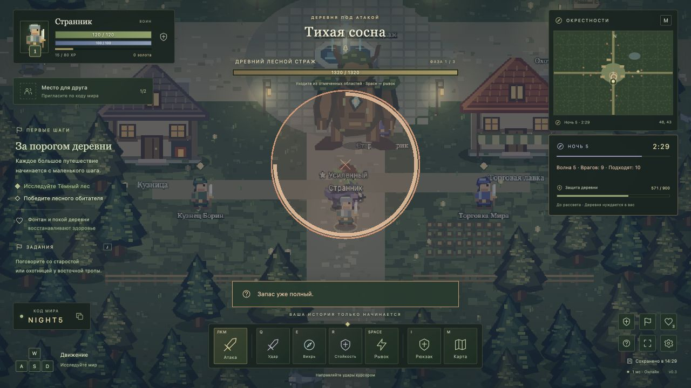

# Village Survival: The Forgotten Lands — v0.4.0

Кооперативная браузерная RPG на Phaser 3, Vite, JavaScript ES Modules, Node.js, Socket.IO и SQLite. Кооперативный постоянный мир, RPG, выживание, добыча ресурсов, ремесло, разрушаемые заборы и девять профессий героев.



## Запуск

Нужен Node.js **22.13+** и npm. SQLite входит в Node.js; на Node 22 допустимо уведомление `ExperimentalWarning`.

```sh
npm ci
npm run dev
```

Открыть **http://localhost:3000**. Vite и игровой сервер работают на одном порту.

Готовая сборка:

```sh
npm run build
npm start
```

Переменные окружения: `PORT` — 3000, `HOST` — `0.0.0.0`, `DB_PATH` — `data/village.sqlite`. Если задан `DATABASE_URL`, миры хранятся в PostgreSQL (Neon); без него локально используется SQLite. Команды запуска читают `.env`, если он существует. Пример переменных — в `.env.example`.

## Размещение на Render + Neon

В репозитории есть `render.yaml` с бесплатным Web Service и подключением внешней базы. Сайт и Socket.IO работают на одном адресе. На Render переменная `DATABASE_URL` обязательна: сервер откажется запускаться с временным SQLite, чтобы не потерять прогресс после засыпания.

Пошаговая настройка и перенос существующих миров: [docs/deploy-render-neon.md](docs/deploy-render-neon.md). Публикация требует аккаунтов и разрешённого доступа к Render, Neon и исходному GitHub-репозиторию.

## Кооператив

1. Первый игрок выбирает имя, класс и облик, создаёт мир.
2. Друг открывает **адрес того же сервера**, выбирает «Присоединиться» и вводит шестизначный код из левого нижнего угла игры.
3. За миром закрепляются два постоянных героя. У каждого своя камера, опыт, предметы и задания.
4. В «Ваших путешествиях» кнопка корзины удаляет запись из вашего списка после подтверждения. Мир, герои и доступ друга сохраняются. Удаление сохраняется после перезапуска сервера. Повторный вход по коду возвращает запись в список.
5. Возвращайтесь через «Ваши путешествия» или по прежнему коду. Когда оба вышли, время мира останавливается. Если остался один игрок, мир продолжает работать.

Для локальной сети используйте `http://<IP-сервера>:3000`. Для интернета нужен доступный сервер или проброс порта. Рекомендуется HTTPS с обратным прокси, поддерживающим WebSocket. Доступ через интернет с двух физических компьютеров в этой среде не проверялся.

Пример Nginx (домен и TLS настраиваются отдельно):

```nginx
location / {
    proxy_pass http://127.0.0.1:3000;
    proxy_http_version 1.1;
    proxy_set_header Upgrade $http_upgrade;
    proxy_set_header Connection "upgrade";
    proxy_set_header Host $host;
    proxy_read_timeout 90s;
}
```

### Чат отряда

Чат открыт при входе в мир и расположен слева внизу. Нажмите **Enter**, чтобы начать ввод, или кнопку **«Чат отряда»**, чтобы свернуть или раскрыть панель. Enter отправляет сообщение и возвращает управление героем, Esc закрывает чат. Пока вводите текст, движение и боевые клавиши отключены; время мира продолжает идти. Сообщения видны только героям вашего мира. У свёрнутого чата есть счётчик непрочитанных сообщений.

Сообщение — до 280 символов. Последние 50 сообщений доступны при повторном входе, пока сервер работает; после перезапуска сервера история очищается. Имя отправителя определяет сервер.

## Ремесло и профессии

1. Каждый новый герой начинает с топориком. Подойдите к дереву в лесу и нажмите **F**; можно держать ЛКМ на близком дереве с топориком в руке. Один удар даёт 6 древесины, дерево выдерживает 3 сбора.
2. У **лесопилки** на юге деревни сделайте своё оружие за 12 дерева или щит за 10. Оружие для своего класса автоматически заменяет топорик. Лук и палочка дают дальнюю основную атаку; топорик у всех классов бьёт вблизи.
3. Продайте 10 древесины Мире, чтобы купить **кирку за 10 монет**. В **северо-западной шахте** F добывает по 3 руды; жила выдерживает 4 сбора. Шахта, лесопилка и алтарь подписаны на карте M.
4. Кузнец делает стальной меч, лук или посох за **8 дерева + 12 руды + 20 золота**. Стальное оружие немного сильнее деревянного. Закалка до +10 требует все три ресурса.
5. На лесопилке **5 дерева → ящик для забора**. B включает строительство, ЛКМ ставит секцию рядом с героем, Esc/B отменяет режим. F возле забора открывает улучшение и ремонт. В мире до 80 секций. Прочность от 160 на 1-м до 790 на 10-м уровне. Следующий уровень L стоит **3 × L дерева, max(1, floor(L/2)) руды и 8 × L золота**. Монстры ломают мешающие им секции; разборка не возвращает материалы.

С **10 уровня** через P выберите одну профессию своего класса. Выбор сохраняется и не меняется. Дополнительный навык — **T**, улучшение прямо над боевой панелью, до 100 ранга.

| Класс | Профессии | Дополнительные эффекты |
| --- | --- | --- |
| Маг | Целитель / Маг огня / Маг льда | Лечение живых союзников / горение на 3 секунды / случайная заморозка при попаданиях и активная ледяная область |
| Лучник | Тёмный лучник / Ассасин / Снайпер | Скелеты после убийств / невидимость и первое критическое попадание / широкая стрела с дальностью 1400 |
| Воин | Агрессор / Оруженосец / Храброе сердце | Отражающий щит / вращающиеся мечи / здоровье, регенерация и второе дыхание |

У тёмного лучника ранг Q открывает 1/2/3/4 скелета на рангах 1/26/51/76. Помощники существуют 25 секунд; их убийства не запускают бесконечную цепь призывов. У оруженосца так же растёт число мечей, но от ранга T. Храброе сердце получает +1,5 здоровья и +0,03 здоровья/с за ранг T. Боссы устойчивее к заморозке. Прежние базовые здоровье и урон монстров сохранены.

Все Q/E/R и T имеют анимацию при каждом применении: взмахи, вихри, снаряды, дождь стрел и метеоров, лёд, пламя, лечение, щиты, дым и вращающиеся клинки. Информационные подсказки и баннеры показываются **один раз каждого типа за приключение**, в том числе после перезахода. Ошибки действий остаются видимыми.

## Третий этап: выживание

### День и ночь

Полный цикл — **7 минут активного времени**: день 5 минут, ночь 2 минуты. За 30 секунд до ночи приходит предупреждение. Пока все игроки отключены, время и нападение стоят на паузе. Сохранения прежнего цикла 7/3 переходят на 5/2 с сохранением номера дня, фазы и доли оставшегося времени. Прогресс героев сохраняется.

### Начало, пропуск дня и поражение

Каждый новый герой начинает с **топориком и 0 золота**. Повторный вход и загрузка сохранения не начисляют монеты заново; золото существующих героев сохраняется.

Кнопка **«Пропустить день»** находится под таймером. В одиночку она сразу начинает текущую ночь. Вдвоём нужно согласие обоих подключённых героев; готовность можно отменить. При подключении или выходе участника голоса сбрасываются. Пропуск не лечит, не выдаёт наград, не ускоряет перезарядки и не сбрасывает ежедневный призыв. Ночь пропустить нельзя.

**Возрождение — только через надгробие.** После гибели на месте героя остаётся надгробие. Живой напарник подходит к нему и нажимает **F**, затем несёт его к **Алтарю** в северо-западной части деревни (бывшая таверна). Рядом со входом герой воскресает автоматически с полным здоровьем и энергией и получает 3 секунды неуязвимости. Инвентарь, золото и опыт сохраняются. Поднимать надгробие можно с полным рюкзаком; оно не занимает ячейку.

Надгробие видно в мире и на карте **M**, алтарь отмечен светлым крестом. Павший герой наблюдает за живым напарником и может писать в чат. Если несущий герой погибнет или отключится, камень останется на его последнем месте; при смерти появится и его собственное надгробие. Надгробия сохраняются после выхода и перезапуска сервера. Автоматического возрождения через 5 секунд больше нет. Старые павшие герои при загрузке получают надгробие на месте гибели.

**Когда все герои отряда погибают, игра заканчивается.** Некому отнести надгробия к алтарю. Мир останавливается, возрождение и игровые действия блокируются. Экран поражения показывает день/ночь и число побед и предлагает новое приключение или выход в меню. Конец игры сохраняется после переподключения и перезапуска сервера. Если живой напарник просто отключился, мир приостанавливается и ждёт его возвращения — поражение не засчитывается.

### Ночная охота

Днём обычных монстров нет. На рассвете ночные враги исчезают без наград за убийство. Ночью все жители деревни скрываются: задания, торговля, ремонт и кузница доступны снова утром. Деревня ночью не лечит.

Каждую ночь приходит **ровно 50 обычных монстров**, для одного и двух героев одинаково. Они появляются с четырёх сторон группами по 5, первая группа сразу, следующие с интервалом 12 секунд. **Босс добавляется только в ночи 3, 6, 9, 12 и далее.** Боссы не создают дополнительные волны помощников.

Базовое здоровье и урон монстров сохранены относительно 0.3.4; скорость всех обычных врагов и боссов уменьшена на **5%**. Каждая следующая ночь по-прежнему добавляет **20% базового здоровья и 15% базового урона**: множители `1 + 0.2 × (ночь − 1)` и `1 + 0.15 × (ночь − 1)`. Усиленные особи получают прежние бонусы. При загрузке старой активной волны её численность и босс подстраиваются под новые правила без наград за убранных врагов и без лечения оставшихся.

Все монстры преследуют живых героев по всей карте, включая деревню. Забор на пути можно разрушить; босс также повреждает секции ударами по области.

### Боссы и обелиск

Босс появляется **каждую третью ночь**: 3, 6, 9, 12 и далее. Чередуются лесной страж, ледяной исполин, пепельный разрушитель и грозовой титан с разными цветами и силуэтами. Их здоровье и урон растут вместе с номером ночи; учитываются уровень и размер отряда.

**Обелиск призыва** на восточной поляне позволяет вызвать отдельного босса **один раз за игровой день для всего мира**. Это исключение из правила отсутствия дневных монстров. Пока призванный босс жив, повторный вызов закрыт. Использованный призыв сохраняется после выхода и снова становится доступен после рассвета. Каждый следующий день усиливает призываемого босса.

Три фазы босса переключаются на 65% и 30% здоровья. Уходите из предупреждающих кругов или используйте рывок. Дополнительных помощников босс не призывает. Босс преследует игроков и может войти в деревню. Живые участники боя в радиусе 1000 пикселей получают личное эпическое оружие своего класса; добыча сохраняется и недоступна напарнику.

Для ручной проверки без ожидания используйте изолированный сервер:

```sh
node tests/fixtures/survival-preview.js
```

Откройте `http://127.0.0.1:3001` и войдите по коду **NIGHT2**. В консоли сервера доступны команды `night 3/6/9`, `day`, `tree`, `mine`, `mill`, `merchant`, `smith`, `shrine`, `materials`, `level`, `profession <id>`, `targets`, `grave`, `defeat`. Команды `night` принимают один номер, например `night 3`; идентификаторы профессий перечислены в `shared/professions.js`. Тестовый герой получает снаряжение и золото; новый мир через меню начинает с нуля. Настоящие базы не используются. Остановите через Ctrl+C.

## Второй этап

### Герои и способности

| Класс | Основная атака | Q | E | R |
| --- | --- | --- | --- | --- |
| Воин | Меч | Мощный удар | Вихрь стали | Каменная стойкость |
| Маг | Магический снаряд | Огненный шар | Ледяной круг | Метеоритный дождь |
| Лучник | Стрела | Пронзающая стрела | Веер стрел | Дождь стрел |

Классы отличаются здоровьем, энергией, бронёй, скоростью, перезарядкой и графикой героя. Способности расходуют энергию, имеют серверные перезарядки и направляются курсором. Дальние области ограничены расстоянием 450 пикселей. Снаряды рассчитывает сервер; стены и деревья блокируют их. Лёд замедляет монстров. Стойкость временно добавляет броню. Маг и лучник не наносят урон напарнику.

Каждый новый уровень даёт **3 очка характеристик** и **3 очка навыков**. Сила усиливает воина, ловкость — лучника, скорость и критический шанс, интеллект — мага и запас энергии, выносливость — здоровье. Навыки Q/E/R и навык профессии T улучшаются до **100 ранга**: +1% базового эффекта за ранг, у стойкости +0,1 брони за ранг. Кнопки + над боевой панелью тратят очки сразу во время игры; Shift + клик добавляет до 10 рангов. Старые ранги 2/3 переходят в новую шкалу с сохранением силы, а существующим героям начисляются дополнительные очки за прошлые уровни один раз.

### Предметы

Рюкзак на 24 ячейки, оружие, броня, сапоги, щиты, шлемы, кольца, зелья здоровья и энергии, материалы. У предметов пять редкостей: обычная, необычная, редкая, эпическая и легендарная. Редкость влияет на характеристики снаряжения. Все шесть слотов поддерживают надевание и снятие через рюкзак и улучшение до +10 у кузнеца днём. Оружие получает +4 урона за улучшение, защитная экипировка +2 брони, сапоги также +2 скорости, кольцо +5 энергии. Для следующего улучшения до уровня L нужны **20 × L золота, 2 + 2 × L дерева и 2 × L руды**. Новые вещи продаются в деревне и выпадают из монстров. Оружие ограничено своим классом; надетые предметы занимают ячейки рюкзака. Зелья, материалы и ящики для забора складываются до 99 штук в ячейке. В списке продажи показаны только ненадетые предметы; любой ненадетый предмет, включая стартовый топорик, можно продать.

После гибели монстр оставляет общую добычу: её может подобрать один из двух героев. Сервер не позволяет подобрать одну вещь дважды, в том числе при одновременных запросах. При полном рюкзаке добыча остаётся на земле. Она исчезает через 10 минут активного времени мира.

В лесу есть три ящика припасов (восточная, западная и южная дороги) и редкий тайник на северной дороге. Каждый герой обыскивает каждый ящик один раз. Прогресс припасов личный и сохраняется даже при сборе до принятия задания. Другой герой может получить свою долю.

### Деревня

- **Староста Эдрик** возле фонтана выдаёт «Первую тропу», «Потерянный караван» и «До первого света».
- **Охотница Рина** у восточного выхода выдаёт задания на 5 волков, 4 гоблинов и Лесного стража.
- **Торговка Мира** возле лавки продаёт зелья и экипировку, покупает ненадетые предметы по одной штуке.
- **Кузнец Борин** создаёт стальное оружие за дерево, руду и золото и улучшает снаряжение до +10.
- **Мастер Олвин** у лесопилки в южной части деревни создаёт деревянное оружие, щиты и ящики для забора.

Подойдите и нажмите **F**. Покупки и получение награды требуют нахождения рядом с нужным NPC. Общие победы засчитываются обоим живым героям в радиусе 600 пикселей, если соответствующее задание принято. Награду нужно забрать у заказчика. Если для предмета-награды нет места, задание остаётся готовым к сдаче, золото и опыт не изменяются. Повторная награда невозможна.

### Управление

| Клавиша | Действие |
| --- | --- |
| WASD / стрелки | Движение |
| ЛКМ, удержание | Атака в направлении курсора |
| Q / E / R / T | Способности / способность профессии |
| + над панелью | Улучшить навык, Shift + клик: до 10 рангов |
| P | Профессия с 10 уровня |
| B / ЛКМ | Режим строительства / поставить забор |
| Space | Рывок, перезарядка 2,4 секунды |
| F | Дерево, руда, забор, надгробие, NPC, сундук или добыча |
| I | Рюкзак и экипировка |
| C | Класс, характеристики и улучшение способностей |
| J | Журнал заданий |
| 1 | Зелье здоровья из рюкзака |
| M | Карта |
| Enter | Открыть чат / отправить сообщение |
| Esc | Закрыть чат / меню, сохранение и выход |

Игра предназначена для клавиатуры и мыши. В спокойной деревне постепенно восстанавливаются здоровье и энергия. Во время нападения лечение отключено. После смерти героя воскрешает напарник, доставив надгробие к алтарю. Деревья и рудные жилы восстанавливаются через 2 минуты активного времени. Пассивное восстановление энергии уменьшено в 5 раз: 2,4/с в спокойной деревне и 1/с вне неё и во время нападения. Зелья энергии восстанавливают прежние 65 единиц.

## Совместимость и сохранения

**Миры первого этапа сохраняются.** При первой загрузке старому герою добавляются рюкзак, стартовое оружие, 3 зелья здоровья, 2 зелья энергии и очки за прежние уровни. Герой может один раз выбрать класс в деревне. Имя, код мира, уровень, опыт, золото, убийства и исследование не сбрасываются. Класс нельзя менять повторно; это не позволяет получать новое стартовое оружие бесконечно.

Локальная база — `data/village.sqlite`; облачная — PostgreSQL из `DATABASE_URL`. Не удаляйте папку `data/` при обновлении. В этой реализации форматы сохранений 1–6 поддерживаются, новые записи используют версию 6. Перед обновлением существующей базы создана отдельная копия в `data/backups/before-stage2-*.sqlite`; перед третьим этапом — в `data/backups/before-stage3-*.sqlite`.

Герой привязан к случайному личному ключу в `localStorage`, независимо от комнаты. Для переноса: **Esc → «Скопировать ключ героя»**, затем **«Восстановить героя»** в другом браузере. Храните ключ у себя. Другу отправляйте только адрес сервера и код мира. Очистка данных браузера без копии ключа лишит доступа к герою.

Сохраняются оба героя, классы, характеристики, очки, ранги и перезарядки, рюкзаки, экипировка, золото, задания, личные открытия ящиков, общая добыча, позиции, здоровье, энергия, монстры и время мира. Профессии, ранги навыков, добытые материалы, истощение ресурсов, заборы с уровнями и прочностью и прочитанные подсказки сохраняются. Снаряды, скелеты-помощники и области заклинаний являются временными эффектами и не восстанавливаются после перезапуска; затраченная энергия и перезарядки сохраняются.

Снимок записывается одной транзакцией SQLite или PostgreSQL. Для SQLite включены WAL и `synchronous=FULL`. Автосохранение — каждые 5 секунд; убийства, награды, RPG-действия, исследования, вход и выход сохраняются сразу. Асинхронные записи выполняются по порядку, лишние ожидающие автосохранения объединяются. Действие подтверждается после записи в базу; симуляция продолжает работать во время запросов. При сбое прогресс остаётся в памяти и запись повторяется, в том числе после выхода игроков. При штатном завершении сервер ждёт окончания записей.

Контрольная сумма SHA-256 и предыдущий снимок защищают от повреждения последней записи. Для резервной копии SQLite остановите сервер и скопируйте всю папку `data/`, включая WAL/SHM, если они остались. Для PostgreSQL используйте отдельные резервные копии, например `pg_dump` с прямым подключением к Neon. Предыдущий снимок не заменяет независимый бэкап.

## Архитектура

- `shared/config.js`, `shared/map.js` — параметры, детерминированная карта, пространственные коллизии.
- `shared/rpg.js` — классы, способности, предметы, NPC, задания и расчёт характеристик.
- `server/world.js`, `server/ai.js` — постоянный мир и ИИ противников.
- `shared/survival.js`, `server/survival.js`, `server/spawns.js` — цикл времени, волны, защита и появление врагов.
- `server/boss.js`, `server/rewards.js` — фазы и атаки босса, персональная добыча и награды.
- `client/survival-ui.js`, `client/game/survival-scene.js`, `client/game/survival-art.js` — ночное освещение, HUD, предупреждения и оригинальная графика босса.
- `server/combat.js`, `server/abilities.js` — попадания, снаряды, области, эффекты и совместные награды.
- `server/inventory.js`, `server/rpg.js`, `server/quests.js`, `server/progression.js` — предметы, торговля, задания, опыт и развитие.
- `server/index.js`, `server/persistence.js` — HTTP, Socket.IO, проверка действий и SQLite.
- `client/game/` — Phaser, оригинальная pixel-art графика, камера, интерполяция и эффекты.
- `client/ui.js`, `client/rpg-ui.js`, `client/styles.css` — меню, HUD, карты, рюкзак, персонаж и диалоги.
- `tests/` — механика, сетевые сценарии, миграция, сохранение и перезапуски.

Сервер рассчитывает мир 20 раз/с, отправляет снимки 10 раз/с, клиент интерполирует перемещения. Клиент не назначает урон, награды, стоимость и свои координаты. Статические коллизии используют пространственные корзины; дальние монстры не отправляются конкретному клиенту. Снаряды ограничены 128 активными объектами на мир и повторно используют объекты из пула. Пустой мир приостановлен.

## Проверка

```sh
npm run check
npm test
npm run build
```

Тесты покрывают классы, базовые способности и все девять профессий, ману и перезарядки, ранги до 100, экипировку и зелья, торговлю и расстояние до NPC, добычу дерева и руды, атомарное изготовление при заполненном инвентаре, постройку, улучшение и разрушение забора, задания, ночные волны и миграцию старых сохранений. Сетевой сценарий проверяет совместную добычу ограниченного ресурса, крафт, сохранение построек и однократных уведомлений после перезапуска. Отдельно проверяются аварийное завершение дочернего процесса и штатное завершение Vite с открытым HMR-соединением.

Проверка обновления 0.4.0: **104 теста пройдены, 3 проверки PostgreSQL пропущены** без `TEST_DATABASE_URL`; синтаксическая проверка и production-сборка успешны. В браузере проверены старт с топориком без золота, рубка, лесопилка, отсутствие надетого оружия в продаже, добыча руды, кузница, постройка и улучшение забора, выбор профессии, быстрое улучшение навыка и анимации. Производственная база для тестов не используется.

Для ручной проверки используйте два разных браузера или профиля. Обычные вкладки одного origin используют одного героя. Создайте мир, примите задания у старосты и охотницы, проверьте Q/E/R в лесу, подберите добычу через F, наденьте оружие, сдайте задание и перезапустите сервер.


## Текущая граница

Не реализованы новые биомы, полноценные подземелья, финальная звуковая полировка и передача предметов между героями. Шахта — точка добычи на общей карте. Заборы строятся, улучшаются до 10 уровня и разрушаются в бою.
